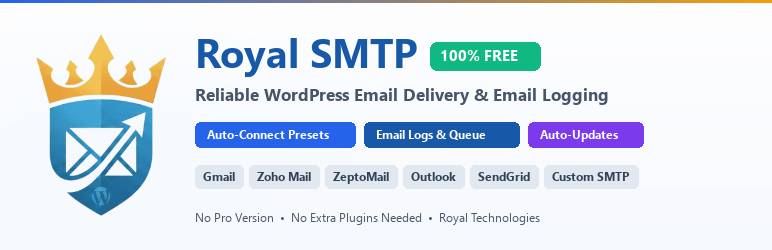

# Royal SMTP

<p align="center">
  
</p>

<p align="center">
  <a href="https://github.com/Royal-Technologies/royal-smtp"></a>
  
  <a href="LICENSE"></a>
  
  
  
</p>

---

## 🌟 100% Free & Open Source — No Pro Version, No Limits!

> **🎉 Royal SMTP is completely FREE forever!**  
> Unlike other SMTP plugins, **there is NO paid "Pro" upgrade, NO paywalls, and NO feature restrictions.**  
> Every feature — from **Email Logging**, **Email Queueing**, **SweetAlert2 Notifications**, to **Automated WordPress Updates** — is 100% free and included out-of-the-box.

---

## 📧 Description

**Royal SMTP** solves WordPress email deliverability problems once and for all. By routing emails through reliable SMTP servers and transactional mail providers, your emails land directly in the inbox instead of the spam/junk folder.

### Key Highlights:
- **100% Free Forever:** All features, all providers, zero restrictions.
- **Auto-Connect Presets:** One-click presets for Gmail, Zoho Mail, Zoho ZeptoMail, Outlook, SendGrid, Brevo, and more.
- **No Third-Party Plugins Required:** Direct SMTP connection for Gmail, Zoho, and ZeptoMail without complex Google Cloud Console or Zoho OAuth configurations.
- **Automated Updates:** Receive new features and bug fixes directly in your WordPress dashboard via GitHub Releases.
- **Detailed Email Logs:** Inspect recipient, subject, headers, delivery status, and resend failed emails.
- **Background Queue System:** Process batch emails smoothly using WP-Cron.
- **SweetAlert2 Alerts & Modern UI:** Beautiful, responsive admin interface.

---

## 🚀 Supported Providers

| Provider | Auto-Connect | Extra Plugin Needed? |
| :--- | :---: | :---: |
| **Gmail / Google Workspace** | ✅ 1-Click Preset | ❌ **No (App Password)** |
| **Zoho Mail** | ✅ 1-Click Preset | ❌ **No (App Password)** |
| **Zoho ZeptoMail** | ✅ 1-Click Preset | ❌ **No (Token Auth)** |
| **Outlook / Microsoft 365** | ✅ 1-Click Preset | ❌ **No** |
| **SendGrid** | ✅ 1-Click Preset | ❌ **No** |
| **Brevo (Sendinblue)** | ✅ 1-Click Preset | ❌ **No** |
| **Mailgun** | ✅ 1-Click Preset | ❌ **No** |
| **Amazon SES** | ✅ 1-Click Preset | ❌ **No** |
| **Postmark** | ✅ 1-Click Preset | ❌ **No** |
| **Custom SMTP Server** | ✅ Custom Config | ❌ **No** |

---

## 🔌 Direct Setup Without Other Plugins (কোনো অন্য প্লাগইন ছাড়া কানেক্ট)

### 1. Gmail / Google Workspace Setup
You **do not need** the Google Cloud Console API or external OAuth plugins!
1. Go to your **Google Account** &rarr; **Security**.
2. Turn on **2-Step Verification** (if not already enabled).
3. Visit [Google App Passwords](https://myaccount.google.com/apppasswords).
4. Create an App name (e.g. `WordPress SMTP`) and copy the 16-character password generated.
5. In **Royal SMTP**:
   - Click the **Gmail** provider card.
   - Enter your Gmail address as **Username** and **From Email**.
   - Paste the 16-character password into **Password**.
   - Save and send a Test Email!

### 2. Zoho Mail Setup
You **do not need** any Zoho developer app or OAuth plugin!
1. Log in to [Zoho Accounts Security](https://accounts.zoho.com/home#security/security_pwd).
2. Under **Application-Specific Passwords**, click **Generate New Password**.
3. In **Royal SMTP**:
   - Click the **Zoho Mail** provider card.
   - Enter your full Zoho email as **Username** and **From Email**.
   - Paste your Application-Specific Password into **Password**.
   - *(Optional for EU/India accounts: Use `smtp.zoho.eu` or `smtp.zoho.in`)*.
   - Save and send a Test Email!

### 3. Zoho ZeptoMail Setup (Transactional Email)
You **do not need** ZeptoMail plugins or SDKs!
1. Log in to your [ZeptoMail Console](https://zeptomail.zoho.com).
2. Go to **Mail Agents** &rarr; select your agent &rarr; **Setup Info** &rarr; **SMTP**.
3. Copy your **Send Mail Token**.
4. In **Royal SMTP**:
   - Click the **Zoho ZeptoMail** provider card.
   - The Username will automatically be set to `emailapikey`.
   - Paste your **Send Mail Token** into the **Password** field.
   - Set your verified sender address in **From Email**.
   - Save and send a Test Email!

---

## 📦 Installation

### From GitHub Release (Recommended)
1. Download `royal-smtp.zip` from [GitHub Releases](https://github.com/Royal-Technologies/royal-smtp/releases).
2. In WordPress Admin, go to **Plugins** &rarr; **Add New** &rarr; **Upload Plugin**.
3. Choose the downloaded zip file and click **Install Now**.
4. Activate the plugin and go to **Royal SMTP** in the admin sidebar.

### Git Clone
```bash
cd wp-content/plugins/
git clone https://github.com/Royal-Technologies/royal-smtp.git
```

---

## 🔄 Automatic Updates

Royal SMTP includes native update checking via GitHub. When a new version is released:
- A notification will appear in your WordPress **Plugins** screen.
- You can enable **Automatic Updates** for Royal SMTP so your site is always running the latest and most secure version.
- You can also view release notes directly inside the WordPress "View Details" popup.

---

## 🛠️ Features Breakdown

- **One-Click Connection Test:** Check socket connectivity to the SMTP host before sending test emails.
- **Instant Test Email:** Send an HTML test email with live SweetAlert2 status alerts.
- **Detailed Email Logs:** Search, filter, view full headers and body, and re-send failed emails with 1 click.
- **Email Queue:** Prevent server timeouts when sending mass emails (WooCommerce orders, newsletters, notifications).
- **Import / Export:** Easily migrate or backup your SMTP configurations.
- **Multilingual Ready:** Full Bengali (`bn_BD`) translation included.

---

## 📄 License & Credits

- **License:** GPL-2.0+ (100% Free & Open Source)
- **Author:** [Royal Technologies](https://royaltechbd.com)
- **Repository:** [https://github.com/Royal-Technologies/royal-smtp](https://github.com/Royal-Technologies/royal-smtp)

**Made with ❤️ by Royal Technologies**
